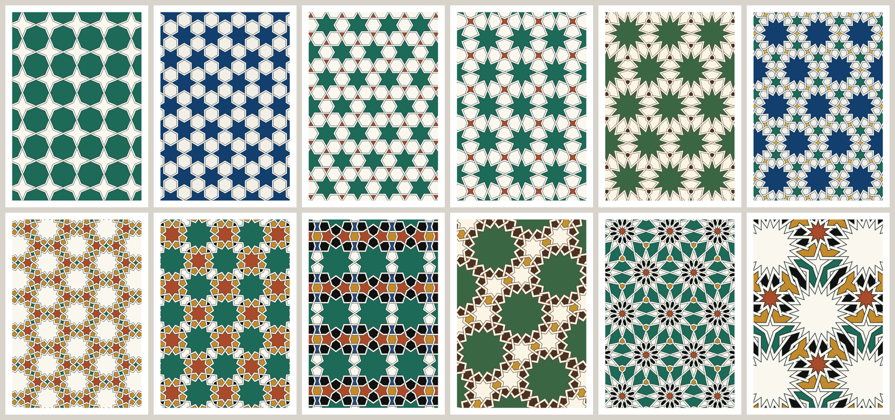

# Láminas hilo

Las láminas hilo reaparecen en los tres primeros movimientos: el lector las **colorea** (I), las **extiende** desde su unidad de repetición (II) y las **reconstruye** desde el círculo (III). Su regreso produce el descubrimiento central del libro: aquel dibujo que coloreó sin entenderlo del todo sale de un círculo dividido en partes iguales.

## Criterios de selección

1. **Patrón evidente.** El lector debe ver de un vistazo cómo se repite el dibujo: retícula alineada con la página, estrella principal en posiciones previsibles y la celda repetida varias veces a lo ancho (entre 2,3 y 9,5 repeticiones).
2. **Construible con regla y compás.** Solo órdenes de simetría construibles (4, 6, 8, 10, 12, 16, 20), para que el Movimiento III se pueda hacer de verdad.
3. **Dificultad creciente.** De 2 a 10 tipos de pieza, siempre sobre una repetición clara. La roseta (11) tiene menos piezas que la lámina 10: su dificultad está en la construcción.
4. **Coloreable.** Ninguna pieza visible por debajo de 4 mm de diámetro equivalente. En las grandes ruedas, la cinta se engrosa hasta tapar las astillas que dejaría el trazado.

Los diseños difíciles de leer (grandes ruedas, girih de 10, retículas propias) no se descartan: se componen (escala, giro, encuadre centrado en la estrella principal, color) para que su repetición se lea. Cuando hay dudas, se ofrecen variantes para que el autor elija.

## Las doce láminas

| # | Lámina | Retícula | Tipos de pieza | Repeticiones a lo ancho | Pieza mínima | Lo que aporta |
|---|---|---|---|---|---|---|
| 1 | Lazo de 4 | Cuadrados | 2 | 4,7 | 22,6 mm | El inicio absoluto: el círculo en 4 |
| 2 | Lazo de 6 | Hexágonos | 2 | 9,5 | 19,1 mm | El círculo en 6, que se divide con el propio radio del compás |
| 3 | Lazo de 6 y 3 | Hexágonos y triángulos | 3 | 8,3 | 6,7 mm | La primera combinación de dos polígonos |
| 4 | Lazo de 8 | Octógonos y cuadrados | 3 | 3,8 | 10,8 mm | La estrella emblemática; la primera estrella secundaria |
| 5 | Lazo de 12 | Dodecágonos y triángulos | 3 | 6,1 | 6,0 mm | Más puntas, mismas piezas |
| 6 | Lazo de 12, 6 y 4 | Dodecágonos, hexágonos y cuadrados | 4 | 6,1 | 6,8 mm | Tres polígonos en la base |
| 7 | Lazo de 12 y 6 | Propia | 4 | 4,4 | 5,9 mm | Jerarquía entre estrellas |
| 8 | Lazo de 12 y 8 | Propia | 5 | 4,9 | 4,9 mm | La misma estrella de 12 con otra compañía |
| 9 | Lazo de 10 | Girih | 6 | 3,5 | 10,4 mm | La familia del pentágono |
| 10 | Lazo de 16 y 8 | Propia | 6 | 4,7 | 4,4 mm | La rueda de 16 |
| 11 | Roseta de 12 | Dodecágonos y triángulos, con rosetas | 5 | 5,4 | 6,9 mm | La estrella se abre en flor: la roseta |
| 12 | Lazo de 20 y 10 | Propia | 10 | 2,7 | 5,5 mm | La culminación |

La familia del 12 tiene cuatro láminas a propósito: es la más rica de la tradición, y verla con distintas compañías enseña que el mismo motivo con otra simetría da otro diseño.

## Variantes elegidas por el autor
- 7 · Lazo de 12 y 6: variante C (celda 50 mm).
- 8 · Lazo de 12 y 8: variante A (estrellas al tresbolillo, celda 55 mm).
- 9 · Lazo de 10: variante A (enderezada, bandas horizontales).
- 10 · Lazo de 16 y 8: variante B (sin girar, celda 80 mm).
- 12 · Lazo de 20 y 10: variante C (celda 120 mm).
- 11 · El lazo de 16 y 6 se descarta; en su lugar, la roseta de 12 (candidata A de cuatro).

## Archivos

Cada lámina (o cada variante) está en `laminas/hilo/NN-nombre/` o `laminas/hilo/NN-nombre/variante-X/`:
- `lamina.svg`: el diseño exportado por capas.
- `diseno.txt`: el código `LAC1…` para abrirlo en el Taller de Lacería.
- `ficha.txt`: la ficha de procedencia.
- `vista.png`: vista previa.

Los colores son los del color automático del taller. La clave de color definitiva de cada lámina se decidirá en la maqueta.
